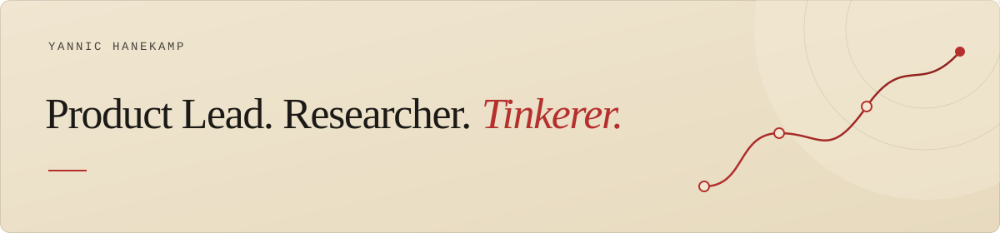

**I help organisations put agentic AI into practice.**

I work hands-on with teams and alongside leadership to explore what is possible, build useful tools and make them work at scale.

## A path through research and building

Curiosity has taken me from studying medicine and publishing peer-reviewed research to co-founding a tech startup. As CEO, I built an international team of **15** and scaled our product to **thousands of paying users**.

Today, I bring that experience to organisations working with agentic AI: connecting experimentation with the practical work of building, adopting and scaling something useful.

## Selected research projects

Two projects from my earlier work on exploring medical literature and making statistical terminology easier to understand.

| Project | What you will find |
| --- | --- |
| [**StatAssist**](https://github.com/qpec/StatAssist_V2) | A Python research prototype that adds explanations of statistical terminology beside medical articles. Includes an example PDF and a guide to the code. |
| [**Altmetric research corpus**](https://github.com/qpec/Altmetric_17K_Top_Articles) | A 2019 collection of 17,299 text extracts from articles selected through Altmetric Explorer, with provenance and limitations documented. |

## What keeps me curious

Unfamiliar territory. Asking questions, testing ideas and building things that did not exist before. I enjoy discovering what is possible, then helping people make it work and scale.
